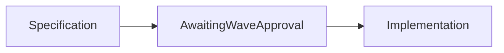

1. RAG over public SEC filings where every claim is checked against its cited passage; unsupported claims get flagged.

2. Result:
   Acceptance: not measured  
   Performance: not measured  
   Correctness: not measured

3. Architecture:

4. Run it:
No runnable implementation yet. This is a planned Wave 2 project.

5. Decisions and limits: Public repository reserved for independent work using public or synthetic data. Implementation has not started. No company affiliation or usage is claimed. Acceptance check: Citation-support rate on 50 questions; examples of caught hallucinations.

6. Next: Implement after approval for Wave 2, then run and publish the required acceptance commands.
